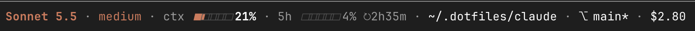

<div align="center">

# statusline-pro

**A configurable status line for Claude Code.**<br>
Model, effort, context, rate limits, directory, git and cost on one line under the prompt, plus badges from your other mods.

[](https://github.com/alexcloudstar/statusline-pro/releases)
[](https://code.claude.com/docs/en/plugins/mods/overview)
[](LICENSE)



</div>

## Install

Needs a Claude Code build that supports [mods](https://code.claude.com/docs/en/plugins/mods/overview) (function hooks).

```text
/plugin marketplace add alexcloudstar/statusline-pro
/plugin install statusline-pro@statusline-pro
```

<details>
<summary>From a terminal instead</summary>

```sh
claude plugin marketplace add alexcloudstar/statusline-pro
claude plugin install statusline-pro@statusline-pro
```

</details>

The line replaces the hint row under the prompt ("? for shortcuts"). It does not touch a `statusLine` configured in `settings.json`; delete that entry if you want only this one.

## Segments

| Id | Shows | `auto` means |
| --- | --- | --- |
| `model` | the active model | always |
| `effort` | reasoning effort | when the model reports one |
| `context` | context window use | always |
| `five_hour` | 5-hour rate limit and reset | always |
| `week` | 7-day rate limit | once usage reaches `week_min_pct` (60) and the limit hasn't reset |
| `dir` | working directory, shortened | always |
| `git` | branch, `*` dirty, `↑n` unpushed | inside a git repo |
| `cost` | session cost | once it reaches `cost_min_usd` (1) |

Gauges turn to the theme's warning color from 60% and its error color from 85% (context: 50% and 80%).

## Settings

`/statusline-pro settings` opens a pane with a live preview. Click a segment's state to cycle `auto`, `always`, `never`; use the arrows to reorder. The same fields are in the `/config` menu and on the install screen.

| Field | Default | |
| --- | --- | --- |
| `show_<id>` | `auto` | `auto`, `always` or `never` for each segment above |
| `week_min_pct` | `60` | usage at which `auto` shows the 7-day limit |
| `cost_min_usd` | `1` | cost at which `auto` shows the cost |
| `separator` | `  ·  ` (a dot with two spaces each side) | text between segments |
| `order` | empty | comma list of ids, first to last; the rest follow in default order |
| `hidden_segments` | empty | comma list of drop-in ids to hide |

`/statusline-pro` with no argument hides or shows the whole line.

## Badges from other mods

Any mod or script can add a segment by writing a JSON file to `~/.claude/status-segments/<name>.json`:

```json
{ "label": "deploy", "text": "v42 live", "color": "warning" }
```

- `text` is required (40 characters). `label` is optional (16). `color` is a theme color name such as `claude`, `warning` or `error`.
- The line reads the folder every 10 seconds and after each turn. Delete the file to drop the segment.
- At most 12 files of 2 KB each. Symlinks are skipped. Control characters are stripped.
- Segments get the id `ext:<name>`. Use it in `order` and `hidden_segments`, or toggle it in the pane.

## What it does and touches

**What it sends and where.** Nothing. It makes no network calls and sends nothing to the model, so it adds nothing to the model's context or your token use. Everything it reads stays on your machine and is drawn on screen.

**Read files never reach a command.** The mod reads local files (the drop-in `.json` files) and runs a program (`git`), but nothing flows from one to the other. The contents of a drop-in file are cleaned, cut to a length limit, and drawn on screen; they are never passed to `git`, to any other command, to the network or to the model. The only values handed to `git` are the three fixed argument lists listed below and the session's working directory, which comes from the session itself, not from a file.

**What it reads.**
- Claude Code's own session figures: model, effort, context, rate limits, cost, working directory.
- The `.json` files in `~/.claude/status-segments/` (or `$CLAUDE_CONFIG_DIR/status-segments/`).
- Its own settings, through the `/config` rows listed under [Settings](#settings).
- The environment variables `HOME` and `CLAUDE_CONFIG_DIR`. It sets none.

**Programs it runs.** Only `git`, read-only, in the session's working directory, every 10 seconds and after each turn, to draw the `git` segment:
- `git rev-parse --abbrev-ref HEAD` for the branch name,
- `git status --porcelain` to tell whether the tree is dirty,
- `git rev-list --count @{upstream}..HEAD` for the number of unpushed commits.

**What it changes.** Nothing on disk. It writes no files. The only thing it sets is its own settings fields (`statusline-pro.*`), and only when you click in the settings pane (`/statusline-pro settings`): the same rows you can edit in `/config`.

**What each hook does.**
- `session.start`: registers the `/statusline-pro` command, loads the first figures, and starts the 10-second refresh of the directory, git state and drop-in segments.
- `turn.step`, `session.measure`, `session.compact`, `turn.complete`: keep the model, effort, context, limits and cost figures current.
- `command.run`: `/statusline-pro` hides or shows the line; `/statusline-pro settings` opens the settings pane.
- `ui.render` for the prompt hint row: draws the status line in place of the hint row.
- `ui.render` for the settings pane: draws the pane and its buttons.

**Every engine call it makes, and where it goes.** None of these sends anything off your machine: each one reads or draws locally, or runs `git`.

| Call | What it does here |
| --- | --- |
| `$.session.model`, `usage`, `cwd`, `surfaces` | reads the session's model, usage figures, working directory and screens |
| `$.env.get` | reads `HOME` and `CLAUDE_CONFIG_DIR` |
| `$.fs.exists`, `list`, `read` | reads the `.json` files in `~/.claude/status-segments/` |
| `$.process.run` | runs the three read-only `git` commands above, with the argument list written out in the call |
| `$.config.list` | reads this mod's own settings rows |
| `$.config.set` | writes this mod's own settings rows (`statusline-pro.*`) when you click in the settings pane; each call names one fixed settings key |
| `$.state.get`, `$.state.set` | keeps the figures in the session's memory; nothing is saved to disk |
| `$.clock.now`, `$.clock.every` | the current time, and the 10-second refresh |
| `$.command.register` | adds the `/statusline-pro` command |
| `$.ui.resolve`, `$.ui.open` | draws the line and opens the settings pane |
| `$.ui.log` | writes a failure message to the debug log only (`claude --debug`), never to the screen or the model |

## Develop

```sh
claude plugin validate .
claude plugin test .
```

Type-check with `tsc` against the types Claude Code writes into `.claude-plugin/types/` once the mod has loaded (`claude --plugin-dir .`).

## License

[MIT](LICENSE)
